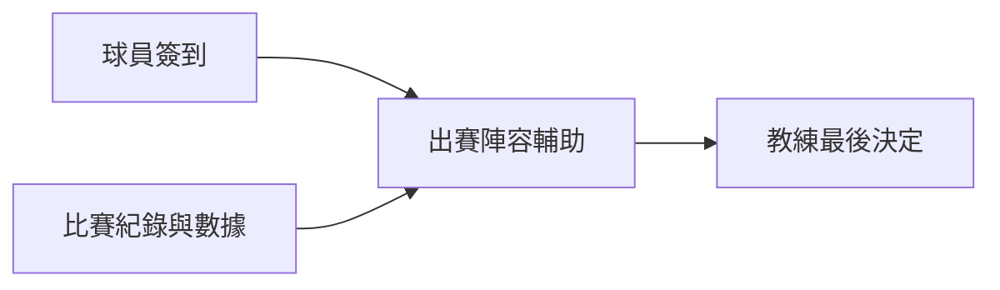

<<<<<<< HEAD
# ⚾ 棒球隊管理與數據分析系統

一套棒球隊管理與數據分析的網頁應用程式，協助球隊以數據輔助決策。
使用者以手機或電腦的瀏覽器即可操作，**不需安裝任何軟體**。

## ✨ 功能

| 功能 | 說明 |
| --- | --- |
| 📱 球員簽到系統 | 球員用手機簽到，記錄每次練習與比賽的出席狀況 |
| 📊 數據資料庫 | 保存球員的比賽紀錄，自動計算打擊率、上壘率等數據，並以排行榜呈現 |
| 📋 出賽陣容輔助 | 綜合出席名單與球員數據，供教練做最後決定 |

## 🔄 系統運作流程

## 🚀 使用方式

1. 以手機或電腦開啟瀏覽器
2. 前往系統網址（部署後補上）
3. 球員：簽到練習或比賽
4. 教練：查看出席名單、數據排行與陣容建議

## 🛠️ 技術架構

> 待補充（前端、後端、資料庫、部署平台）

## 📁 專案結構

> 待補充

## 🗺️ 開發進度

- [ ] 球員簽到系統
- [ ] 數據資料庫與排行
- [ ] 出賽陣容輔助功能
- [ ] 部署上線

## 📄 授權

待補充
=======
# 善良的棒球男孩想幫球經減輕負擔

本專題開發一套棒球隊管理與數據分析的網頁應用程式，協助球隊以數據輔助決策。

使用者以手機或電腦的瀏覽器即可操作，不需安裝軟體。
系統包含三項功能：

球員簽到系統讓球員用手機簽到，記錄每次練習與比賽的出席狀況；數據資料庫保存球員的比賽紀錄，自動計算打擊率、上壘率等數據並以排行呈現；出賽陣容協助功能綜合出席名單與球員數據，供教練做最後決定。
>>>>>>> bdc1e382bd8d647e1dacea4f9efde38db5f37f08
